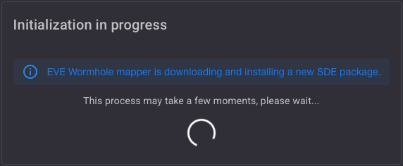
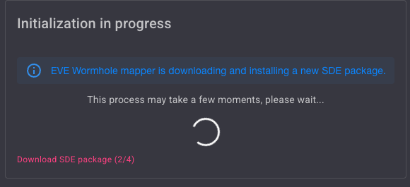
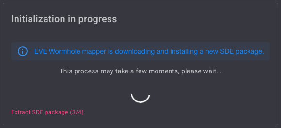
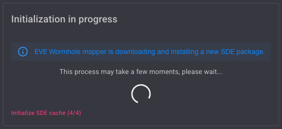
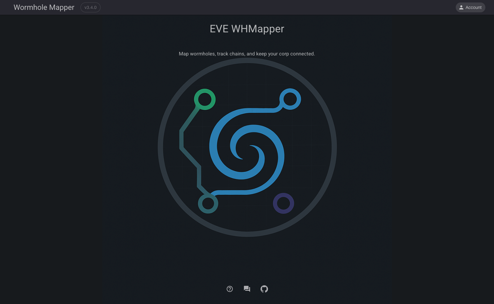

On first start, EVE Wormhole Mapper prepares its database and the EVE static data it needs. Both steps are automatic — no action is required.

## Initialization

:::info
- **Database**: the PostgreSQL schema is created, or migrated to the new version, every time the application starts.
- **Static data (SDE)**: the first time the home page is opened, WHMapper downloads and installs the EVE Static Data Export (SDE). This happens again only if the SDE is missing, for example after its files were removed.
:::

The SDE installation shows the following steps:

- **Remove Current SDE Package (1/4):** The existing Static Data Export (SDE) package is removed to ensure no outdated data interferes with the new setup.
- **Download SDE Package (2/4):** The latest SDE package is downloaded. This package contains critical game data required for accurate wormhole mapping.

- **Extract SDE Package (3/4):** The downloaded package is extracted, preparing the data for use.

- **Initialize SDE Cache (4/4):** The system initializes the SDE cache, optimizing performance and ensuring all data is readily accessible.

Once these steps are completed, the main page is displayed and the application is ready for use.

## Sign In

For the first login, you need to authenticate your account. Refer to the **[Authentication Module](../Module/authenticate.md)** for detailed instructions.

---

**Next step →** [Authentication](../Module/authenticate.md)