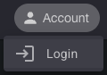
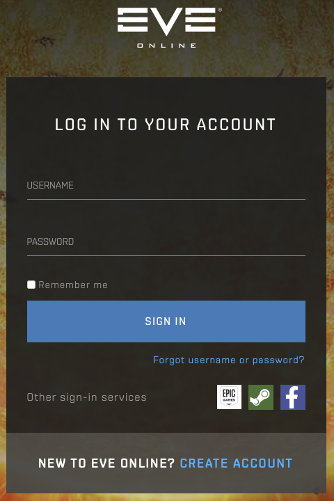
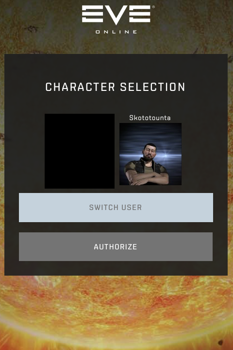
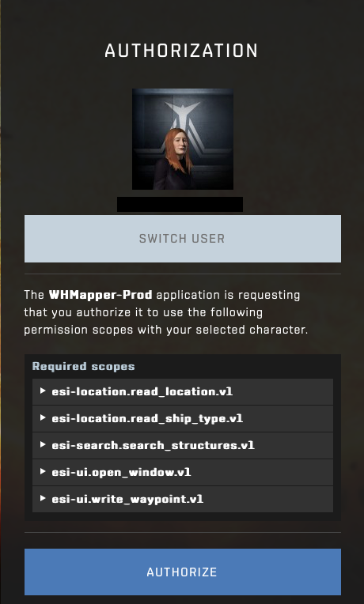
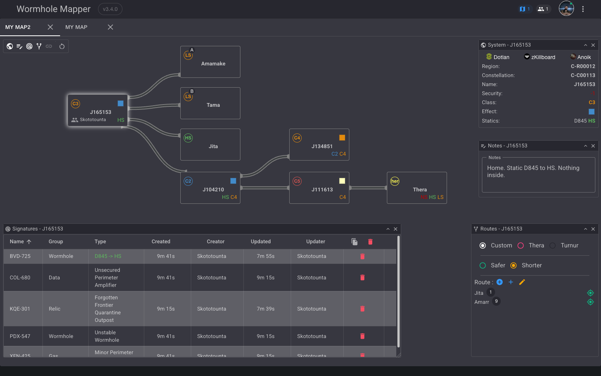
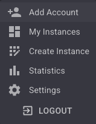
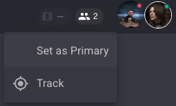

WHMapper uses your EVE Online account through CCP's Single Sign-On (SSO). Your password is never sent to WHMapper — only a token issued by CCP is stored.

## Login flow

1. **Open the account menu** — click **Account** at the top-right of the home page.

   

2. **Initiate Login** — click **Login** to be redirected to the CCP SSO page.

   

3. **Enter CCP Credentials** — input your CCP username and password.

   

4. **Select a Character** — choose which character to use.

   

5. **Authorize Scopes** — review and approve the required access rights.

   

## After login

Once CCP has authenticated you, WHMapper checks which instances you can access:

- **You belong to an instance** — the first accessible map loads automatically.

  

- **You don't belong to any instance** — the *No Instance Access* screen is shown. You can create your own instance or ask an administrator to grant you access.

  Refer to the **[Instance](./instance.md)** page for the full walkthrough.

## Multiple characters

You can link several EVE characters to the same session using the **Add Account** button.

Each linked character appears as a badge in the top bar. The **primary character** — used for all mapper actions and access checks — is highlighted with a white circle.

To change the primary character, right-click another character's badge and choose **Set as Primary**. The maps you can open follow the access rights of the primary character.

The same menu enables or disables location tracking for each character (see [Map → Pilot Tracking](./map.md#pilot-tracking)).

---

**Next step →** [Instance Setup](./instance.md)
