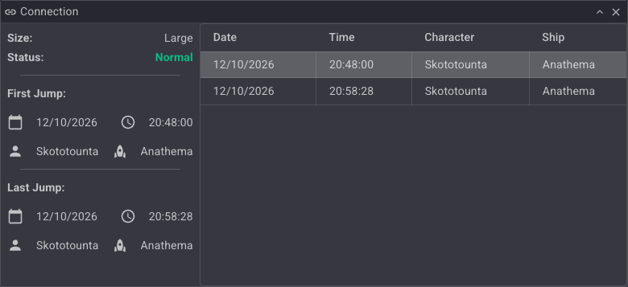
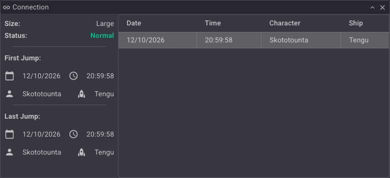
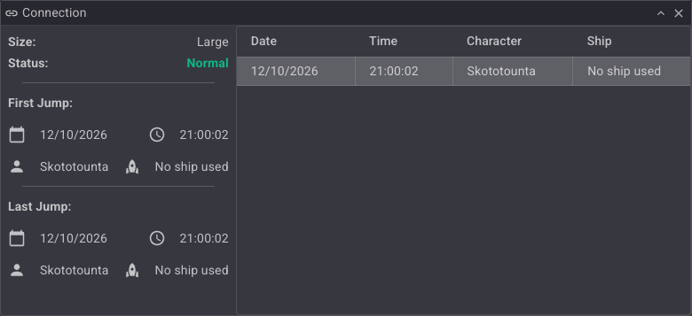
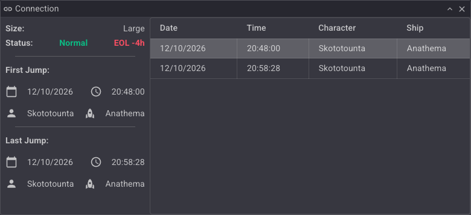
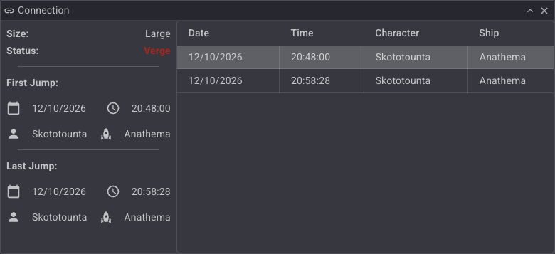

WHMapper records every jump through a connection: who jumped, when, and in which ship. With the connection's status and size, the jump log helps you judge how much mass a wormhole has left before you send more ships through.

## Connection window

Select a connection on the map to open the **Connection** window (see [Map panels](./map.md#map-panels)).

The left side summarizes the connection:

| Field | Description |
|---|---|
| **Size** | Size of the wormhole: Small, Medium, Large or XLarge |
| **Status** | Current status of the wormhole (see [Wormhole status](#wormhole-status)) |
| **First Jump** | Date, time, character and ship of the first recorded jump |
| **Last Jump** | Date, time, character and ship of the most recent jump |

The right side lists every recorded jump:

| Column | Description |
|---|---|
| **Date** | Date of the jump (EVE time) |
| **Time** | Time of the jump (EVE time) |
| **Character** | Character who jumped |
| **Ship** | Ship used, or *No ship used* if the connection was created manually |

## How jumps are recorded

### Tracked jumps

When a tracked character jumps through a wormhole, WHMapper records the jump with the ship flown at that moment (see [Pilot tracking](./map.md#pilot-tracking)).

Every jump through the same connection is added to the log, and **First Jump** / **Last Jump** are updated (see the two jumps in the first screenshot).

### Manual connections

When you create a connection by hand on the map, no ship is recorded: the log shows **No ship used**.

## Wormhole status

**Status** shows the mass status of the wormhole. When the wormhole is at end of life, its EOL status is shown next to it. Both are set from the connection menu on the map (see [Editing a connection](./map.md#editing-a-connection)).

| Status | Colour | Meaning |
|---|---|---|
| **Normal** | Green | Mass not reduced |
| **Reduced** | Orange | Mass reduced: a large ship or several ships went through |
| **Verge** | Red | About to collapse |
| **EOL -4h** | Purple | End of life, less than about 4 hours left |
| **EOL -1h** | Purple | End of life, less than about 1 hour left |

Mass status Normal with EOL -4h:

Mass status Verge:

