The map shows your wormhole chain: the systems you have found and the connections between them, through wormholes or stargates. Every change is synchronized live, so all pilots on the same map see the same chain at the same time.

From the map you can:

- track where your characters are and let WHMapper add the systems they enter;
- add, move, lock, tag and delete systems;
- set the status, size and end of life of each connection;
- open the System, Notes, Signatures, Routes and Connection windows for the selected item.

Who can open a map is set per instance and per map (see [Instance](./instance.md)).

## Connected users

The top bar shows how many pilots are currently on the **active map tab**. The count updates live as pilots join, leave or switch tabs.

:::tip
The count only covers the active tab. Make sure your fleet uses the same map tab to get an accurate number.
:::

## Pilot tracking

When tracking is on, WHMapper follows each of your characters through ESI:

- the system a character enters is added to the active map;
- the connection between the previous and the new system is created automatically;
- the character's name appears on the system it is in.

After you log in, tracking is on for every character. A green dot on a character badge means tracking is on:

### Turn tracking on or off

Right-click a character badge in the top bar:

- **UnTrack** turns tracking off for that character (red dot):

  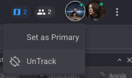

- **Track** turns it back on (green dot):

  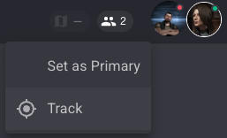

Tracking only works on maps the character can open. When a character has no access to the active map, its badge shows a red dot and the menu shows **No Map Access**:

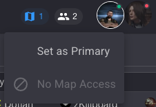

### Automatic tags

When several systems of the same class are connected to the same origin, WHMapper gives them sequential letters (A, B, C…). Use these letters to name your in-game bookmarks.

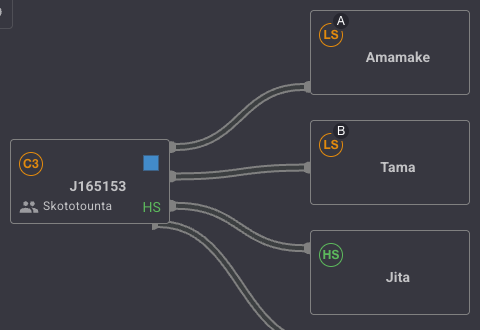

To change a tag, select the system and press (default bindings, see [Settings → Keyboard](./settings.md#keyboard-tab)):

- `Numpad +` or `Arrow Up`: next letter (A → B);
- `Numpad -` or `Arrow Down`: previous letter (B → A).

Bookmark examples:

| Bookmark | Meaning |
|---|---|
| `>> LS - EJC` | Low-security exit |
| `>> LSB - KWE` | Second low-security exit from the same origin |
| `>> HS - MCE` | High-security exit |

## Selection

A selected system or connection is highlighted, and the windows for it open over the map (see [Map panels](#map-panels)).

### Select a system

Left-click a system.

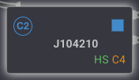

These windows open:

- **System** and **Notes** — see [System Information](./system_infos.md);
- **Signatures** — see [Signature](./signature.md);
- **Routes** — see [Route Planner](./route_planner.md).

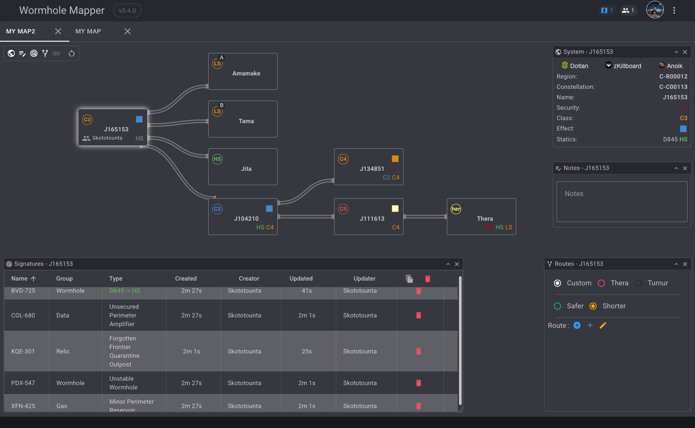

### Select a connection

Left-click a connection.

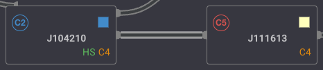

The **Connection** window replaces the system windows. It shows the connection's size, status and jump log (see [Jump](./jump.md)).

### Selecting multiple systems

- `Ctrl` + left-click adds a system to the selection, or removes it if it is already selected. This can be turned off in [Settings → Mouse / Zoom](./settings.md#mouse--zoom-tab).
- `Shift` + left-click and drag draws a selection area. Every system inside it is selected:

  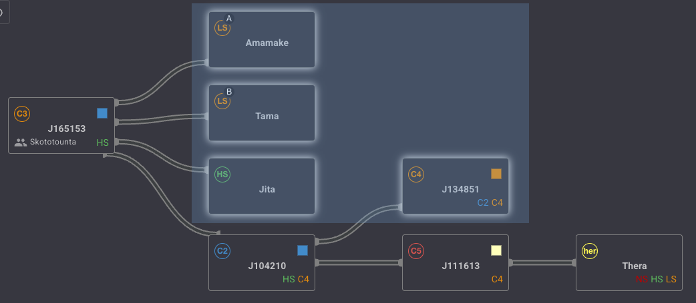

  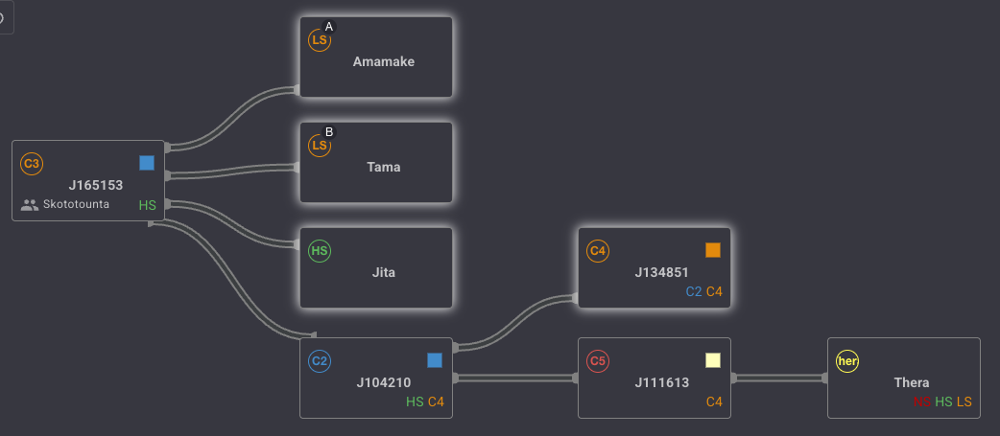

## Map panels

The **System**, **Notes**, **Signatures**, **Routes** and **Connection** windows float over the map. The map stays usable around them: clicks, right-clicks and zoom outside a window reach the map.

- **System**, **Notes**, **Signatures** and **Routes** follow the selected system. By default, System and Notes are top-right, Signatures bottom-left and Routes bottom-right.
- **Connection** follows the selected connection and replaces the system windows while a connection is selected.

### Move a window

Drag a window by its **title bar**. The window comes to the front when you press or move it, and always stays inside the map.

### Collapse and close

Each title bar has two buttons:

- the **collapse arrow** reduces the window to its title bar, or expands it again;
- **Close** (`×`) hides the window.

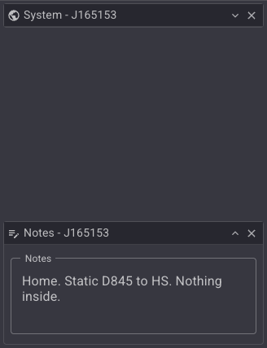

### Panel dock

The dock at the top-left of the map shows or hides each window. A highlighted icon means the window is shown.

A window that does not apply to the current selection has a disabled button. Hover it to see why:

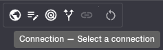

The last button, **Reset panel layout**, puts every window back in its default place, visible and expanded.

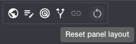

### Resize the Signatures window

Drag the grip in the bottom-right corner of the **Signatures** window to resize it. It keeps a minimum size and stays inside the map. Long lists scroll inside their window.

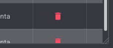

### Last selection

When you clear the selection, for example by clicking an empty area of the map, the windows keep showing the last selected system or connection, dimmed. The title bar shows the system name, so you always know what is displayed.

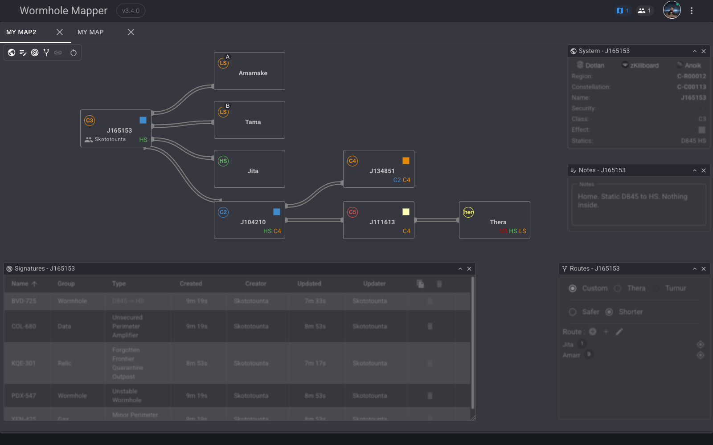

### Saved layout

Position, size, visibility and collapsed state are saved **per map, in your browser**, and restored when you reload the page. Each pilot can arrange the windows to fit their screen; the layout is not shared with other users or devices.

## Moving systems

- **One system**: drag it to its new position.
- **Several systems**: select them (see [Selecting multiple systems](#selecting-multiple-systems)), then drag any of them to move the whole group.

Locked systems cannot be moved (see [Lock a system](#lock-a-system)).

## Adding systems

Systems are added automatically by [pilot tracking](#pilot-tracking). To add one manually:

1. Right-click an empty area of the map and choose **Add System**.

   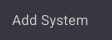

2. Type at least three characters of the system name.

   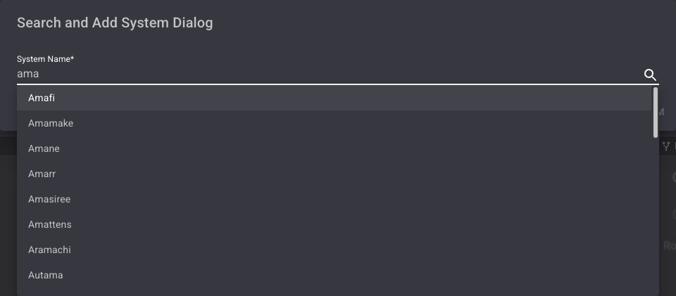

3. Choose the system in the list (here, Amamake), then click **ADD SYSTEM**.

   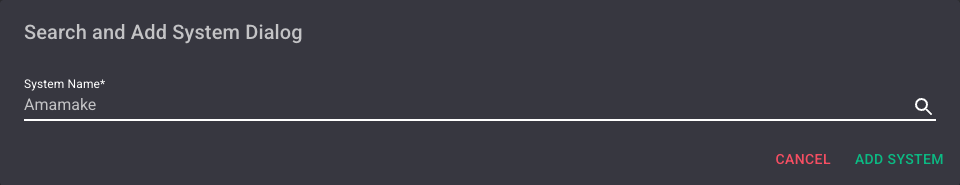

A notification confirms that the system was added.

## Editing a system

Right-click a system to open its menu.

### Set destination

**Set Destination** sets the system as your autopilot destination in the game.

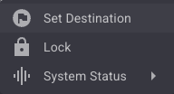

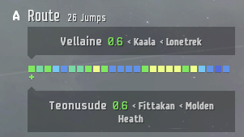

### Lock a system

**Lock** protects a system: it can no longer be moved or deleted. A padlock appears on the system.

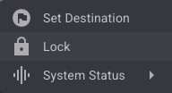

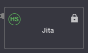

To remove the protection, choose **UnLock** in the same menu.

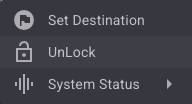

### System status

**System Status** marks what you know about a system. The status is shown by the border colour of the system.

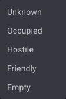

| Status | Meaning | Appearance |
|---|---|---|
| **Unknown** | No information about this system | 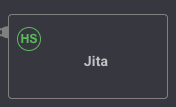 |
| **Occupied** | Occupied by potential enemies | 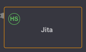 |
| **Hostile** | Enemies present | 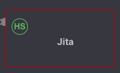 |
| **Friendly** | Allies present | 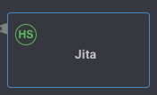 |
| **Empty** | Nobody in the system | 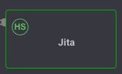 |

## Editing a connection

Right-click a connection to open its menu.

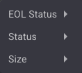

### End of life

**EOL Status** sets how long the wormhole has left before it collapses.

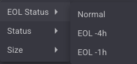

| EOL status | Meaning | Appearance |
|---|---|---|
| **Normal** | Not at end of life |  |
| **EOL -4h** | About 4 hours left (dashed purple) | 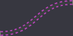 |
| **EOL -1h** | About 1 hour left (solid purple) |  |

### Mass status

**Status** sets how much mass the wormhole has left.

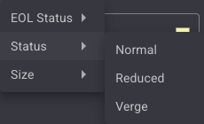

| Status | Meaning | Appearance |
|---|---|---|
| **Normal** | Mass not reduced |  |
| **Reduced** | Mass reduced |  |
| **Verge** | About to collapse |  |

### Size

**Size** sets the largest ship class that can jump through the wormhole.

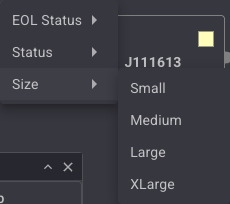

| Size | Appearance |
|---|---|
| **Small** |  |
| **Medium** |  |
| **Large** (default) |  |
| **XLarge** |  |

## Deleting systems

1. Select the system, or several systems (see [Selecting multiple systems](#selecting-multiple-systems)).
2. Press `Delete`.

:::warning
- There is **no confirmation**: check your selection before pressing `Delete`.
- A locked system cannot be deleted. WHMapper shows a warning instead:

  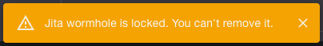
:::
