The **Routes** window counts how many jumps separate the selected system from your key destinations (trade hubs, home, staging…). It uses stargates and the wormholes on your map, and can also use Thera and Turnur connections.

The window opens over the map when you select a system (see [Map panels](./map.md#map-panels)). Jump counts are recalculated each time you select another system.

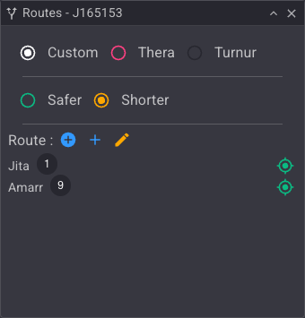

## Route type and preference

| Route type | Connections used |
|---|---|
| **Custom** (default) | Stargates and the wormholes mapped in WHMapper |
| **Thera** | Custom, plus the current Thera connections |
| **Turnur** | Custom, plus the current Turnur connections |

| Preference | Effect |
|---|---|
| **Shorter** (default) | Fewest jumps |
| **Safer** | Prefers high-sec, even if the route is longer |

Example from J165153 with Thera, **Shorter** then **Safer**:

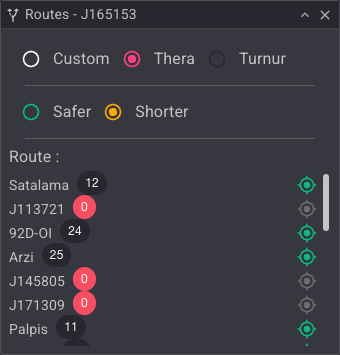

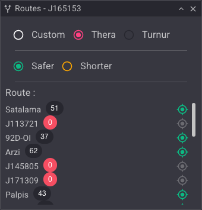

:::info
Thera and Turnur connections change during the day, so their jump counts change too.
:::

## Destination lists

There are two kinds of destinations:

- **Global** destinations are set by instance administrators and shown to everyone who can open the map;
- **personal** destinations are your own, added on top of the global ones.

The buttons next to **Route** depend on your role:

| Button | Action | Who |
|---|---|---|
|  | **Add a global new route** | Administrators |
|  | **Add my new route** | Everyone |
|  | **Edit a route** | Administrators, and pilots who have personal destinations |

Administrator view:

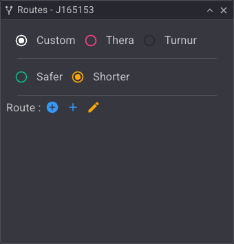

Pilot view:

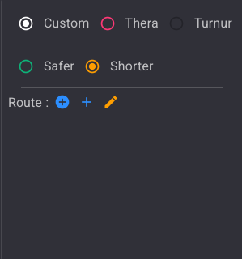

:::info Multiple characters
Personal destinations are recorded under your **primary character**, whichever character is active (see [Authenticate → Multiple characters](./authenticate.md#multiple-characters)).
:::

## Add a destination

1. Click **Add a global new route** (administrators) or **Add my new route**.
2. Type at least three characters of the system name, for example `Jita`:

   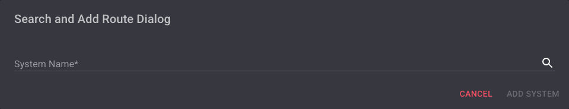

   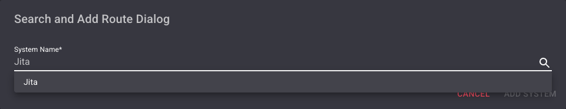

3. Choose the system, then click **ADD SYSTEM** (or **CANCEL** to close).

The destination is added with its jump count from the selected system:

## Remove a destination

1. Click **Edit a route** . A trash icon appears next to each destination you can remove:

   - administrators can remove global and personal destinations:

     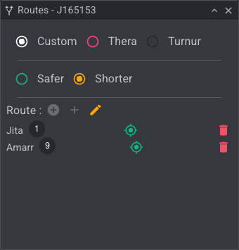

   - pilots can remove their own personal destinations:

     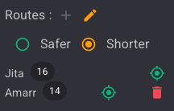

2. Click the trash icon  next to the destination.
3. Click **DELETE** to confirm.

   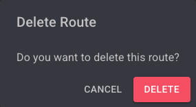

## Reading the jump counts

When a route exists, the number of jumps is shown next to the destination, with a green target icon. A route can go through mapped wormholes, stargates, and Thera or Turnur connections when that route type is selected.

- From a wormhole (J165153):

  

- From known space (Jita):

  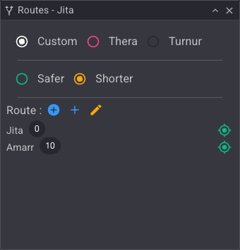

When no route is found, the count shows **0** in red and the target icon is greyed out. This happens when the selected system, or the destination, is not connected to the rest of your map.

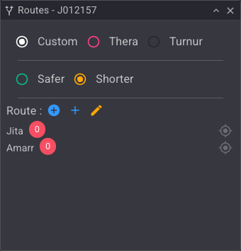

## Show a route on the map

Click the target icon next to a destination to highlight its route on the map, in yellow. Click it again to hide the route.

| Show the route | Hide the route |
|---|---|
|  |  |

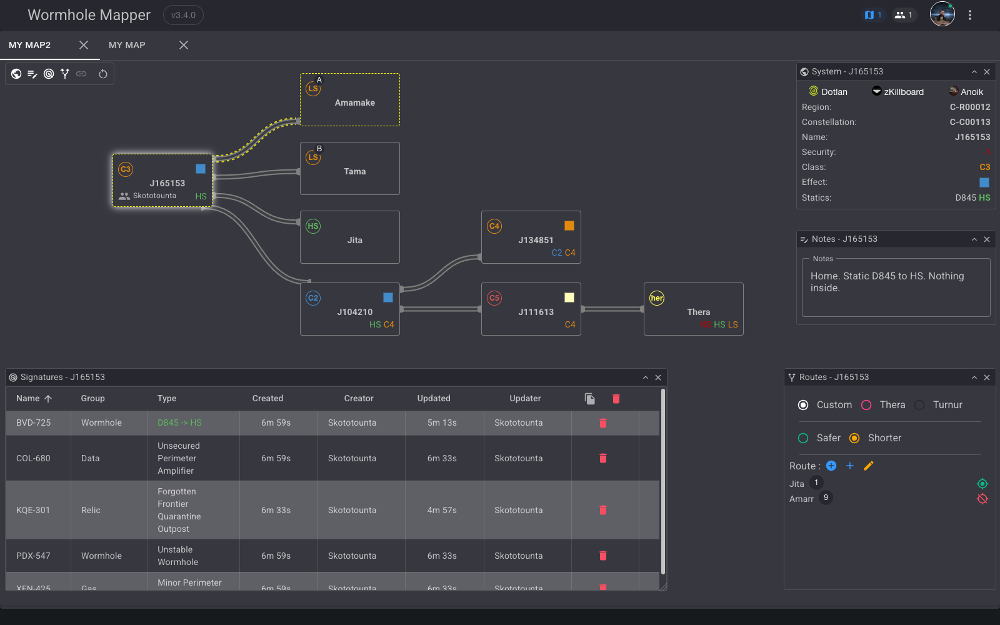

:::note
Only systems that are on your map are highlighted. Known-space jumps that are not mapped are part of the route, but are not drawn.
:::

### See every system of a route

Hover the jump count of a destination to see the whole route as a row of dots, one per system, coloured by security status. Hover a dot to see the system name.

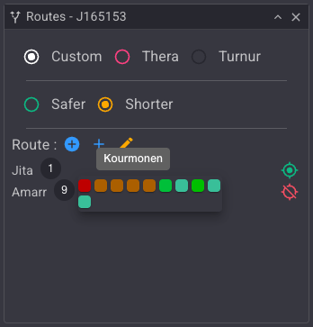
