A signature is a point of interest found with probes: a wormhole, or a data, relic, combat, gas or ore site. WHMapper keeps the signatures of each system and shares them live with every pilot on the map, so you know what has already been scanned.

When you select a system on the map, its signatures are shown in the **Signatures** window. This window can be moved, collapsed and resized (see [Map panels](./map.md#map-panels)).

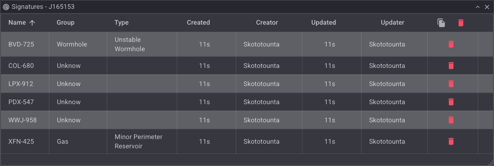

With the Signatures window you can:

- paste the in-game scan results to add or update many signatures at once;
- see who created or last updated each signature, and when;
- set the wormhole type of a signature, with its destination class;
- delete expired signatures, one by one or all at once.

## Import signatures

1. In the game, open the **Probe Scanner** and select the signatures to copy (`Ctrl+A`, then `Ctrl+C`).

   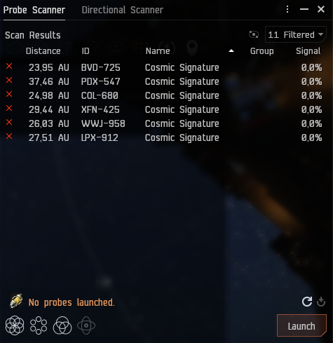

2. In WHMapper, check that the right system is selected, then click the import button  in the Signatures window.

3. Paste the scan into **Scan Result**. WHMapper checks the format for every supported EVE language and shows a preview:

   - nothing probed yet:

     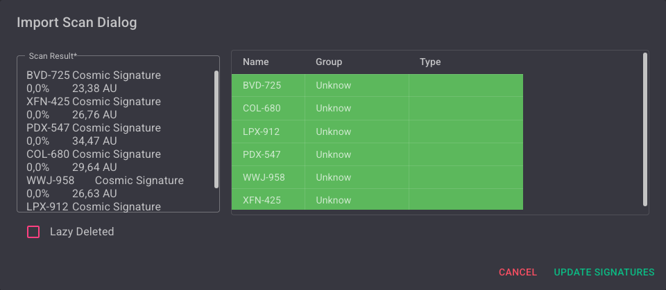

   - some signatures probed:

     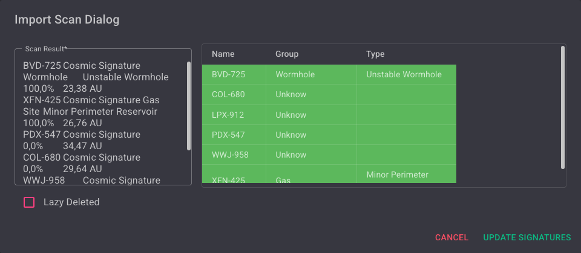

4. Click **UPDATE SIGNATURES**. The signatures appear in the Signatures window:

   

The first pilot to import a signature is its **Creator**. Each later import or edit of the same signature records the **Updater** and resets the **Updated** timer. These timers help you spot old signatures before their wormhole collapses.

### Lazy Deleted

The **Lazy Deleted** option compares your scan with the signatures already saved:

| Colour | Lazy Deleted off (default) | Lazy Deleted on |
|---|---|---|
| **Green** | New signature | New signature |
| **Grey** | Updated signature | Updated signature |
| **Red** | — | Saved signature missing from your scan: it will be **deleted** |

Starting from the signatures above, a new scan gives:

- Lazy Deleted off:

  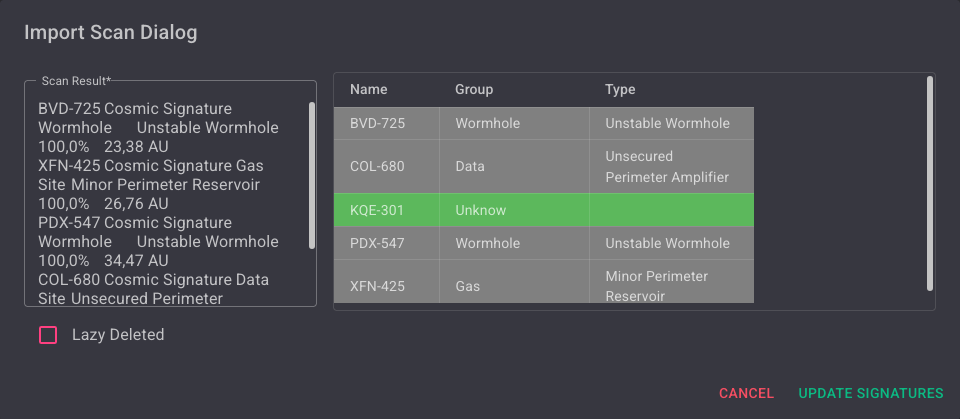

- Lazy Deleted on:

  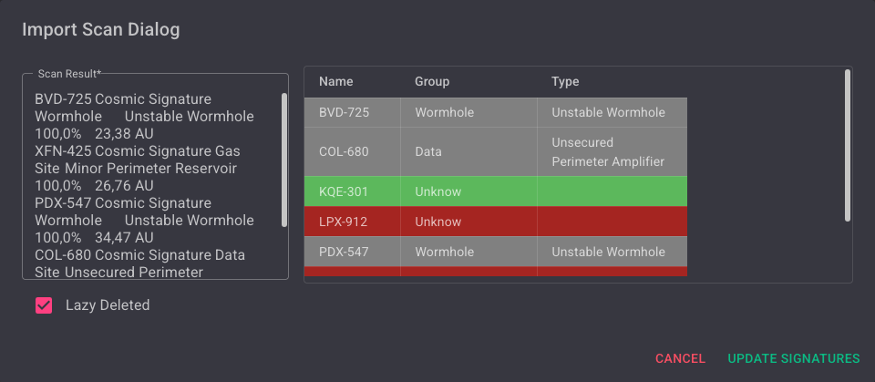

:::tip
The red rows tell you which bookmarks to remove in the game.
:::

:::warning
Only turn on Lazy Deleted when you paste **all** the signatures of the system. With a partial selection, the signatures you did not copy are deleted.
:::

## Update signature manually

Imports update signatures automatically. You can also edit a signature by hand, for example to set the type of a wormhole:

1. Click the row to edit it.
2. Choose the **Group**:

   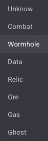

3. Set the **Type**:
   - for a wormhole, choose the wormhole type in the list. Each entry shows the type and its destination class (HS, LS, NS, C1–C6…):

     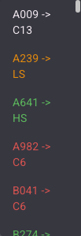

   - for any other group, type free text:

     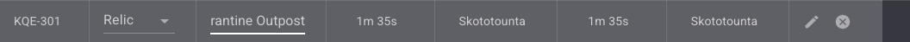

4. Click the pencil to save, or the cross to cancel:

   

Example: a wormhole set to `D845 -> HS`, about to be saved:

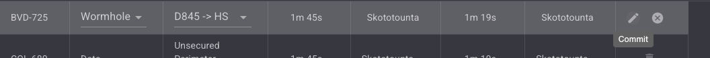

## Delete a signature

1. Click the trash icon  at the end of the row.

   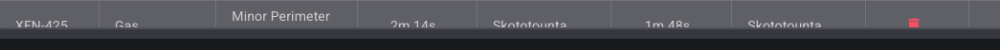

2. Click **DELETE** to confirm, or **CANCEL** to keep the signature.

   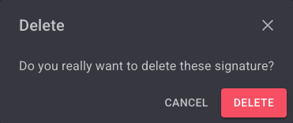

## Delete all signatures

1. Click the trash icon  next to the import button  in the table header.
2. Click **DELETE** to delete every signature of the system, or **CANCEL** to keep them.

   
