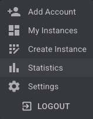
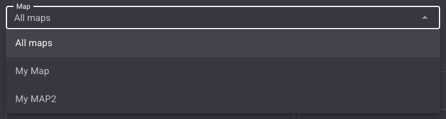
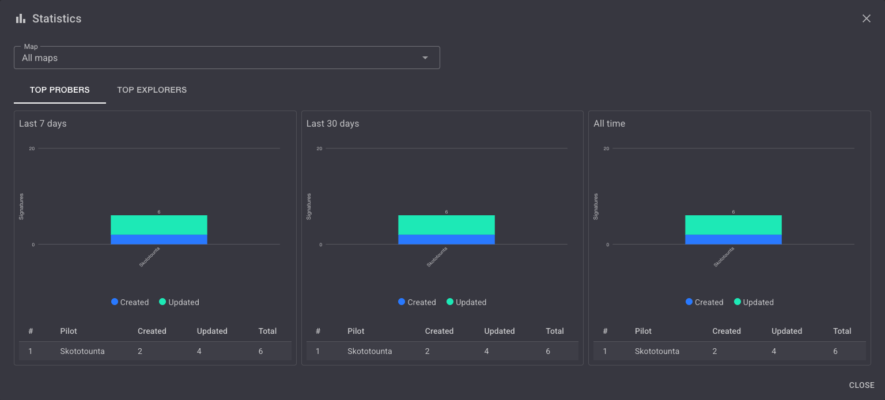
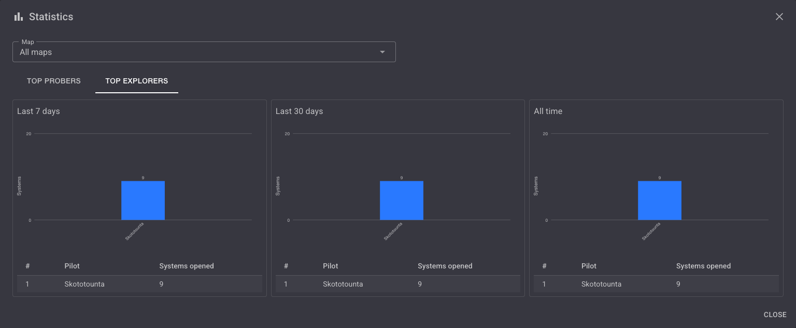

## Introduction

The **Statistics** module shows who probes and who explores the most on your maps. It helps your corporation recognise the pilots carrying the scanning and scouting effort.

The leaderboards are built from WHMapper's own activity history, stored in its database.

### Key Features

- **Top Probers**: pilots ranked by signatures they scanned down or identified.
- **Top Explorers**: pilots ranked by systems they opened on a map.
- **Three periods side by side**: last 7 days, last 30 days and all time.
- **Filters**: by instance and by map.
- **Your own row is highlighted** so you can find yourself at a glance.

---

## How to Open Statistics

Open the user menu (`⋮` at the top-right of the screen) and click **Statistics**.

---

## Filters

| Filter | Description |
|---|---|
| **Instance** | The instance to report on. Shown only when you can access more than one instance. |
| **Map** | A single map, or **All maps** (default). |

Only activities on maps **you are allowed to open** are counted, including per-map access restrictions (see [Instance → Map Access Control](./instance.md#map-access-control)).

---

## Top Probers

The **TOP PROBERS** tab ranks pilots by the number of signatures they created and updated. Each period shows a stacked bar chart (**Created** / **Updated**) and a table.

| Column | Description |
|---|---|
| **#** | Rank |
| **Pilot** | Character name |
| **Created** | New signatures added to a system |
| **Updated** | Existing signatures whose name, group or type changed |
| **Total** | Created + Updated |

Ties are broken by the number of created signatures.

### What Counts

- **Signature created**: a new signature added by a scan import (paste or Import dialog) from a line at **100% signal strength**.
- **Signature updated**: an existing signature whose name, group or type changes:
  - by a scan import from a line at **100% signal strength**, or
  - by a [manual edit](./signature.md#update-signature-manually) that leaves the signature identified (group other than *Unknow* and type filled in).
- Signatures probed below 100% are still stored as usual, but they are **not counted**.
- Refreshing the scan date of a signature alone is **not counted**.

---

## Top Explorers

The **TOP EXPLORERS** tab ranks pilots by the number of systems they opened on a map. Each period shows a bar chart and a table.

### What Counts

- **System opened**: each system added to a map where it was not already present, either by automatic location tracking or manually (see [Map → Adding Systems](./map.md#adding-systems)).

---

## Periods

Each leaderboard shows the **Top 10** for three periods displayed side by side:

| Period | Description |
|---|---|
| **Last 7 days** | Rolling window, in UTC |
| **Last 30 days** | Rolling window, in UTC |
| **All time** | Everything recorded since the module was deployed |

Pilot names are resolved from ESI. When a name cannot be resolved, the character ID is shown instead.

---

## Good to Know

:::info Leaderboards start empty
Activity is recorded from the moment WHMapper v3.4.0 is deployed. Past activity is **not** backfilled, so leaderboards start empty and fill up as your pilots scan and explore.
:::

- Signature activity is recorded under your **primary character** (see [Authenticate → Multiple Characters](./authenticate.md#multiple-characters)). A system opened by location tracking is credited to the character who entered it.
- Deleting a map or a system does **not** delete its activity history.
- Recording never interrupts map operations: if an activity cannot be saved, the map action still completes.
