When you select a system on the map, two windows open over the map (see [Map panels](./map.md#map-panels)):

- **System** shows what you need to know about the system: location, security, class and, for wormholes, the effect and statics;
- **Notes** holds a free-text note about the system, shared with everyone on the map.

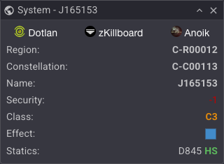

## Third-party links

The top of the System window links to the selected system on three websites:

| Link | Use it for |
|---|---|
| [Dotlan](https://evemaps.dotlan.net/) | Maps of the region and constellation, jumps and activity |
| [zKillboard](https://zkillboard.com/) | Recent kills and losses in the system |
| [Anoik.is](http://anoik.is/) | Wormhole details: effect, statics, celestials |

## System details

The System window shows the region, constellation, name, security status and class of the system.

### Security status

The security status is colour-coded:

| Colour | Security status | Example |
|---|---|---|
| **Red** | Below 0 (null-sec and wormholes) |  |
| **Orange** | 0.1 to 0.4 (low-sec) | 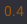 |
| **Green** | 0.5 and above (high-sec) | 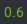 |

### System class

The class badge tells you what kind of space the system is in.

**Known space:**

| Class | Badge |
|---|---|
| High-sec (HS) |  |
| Low-sec (LS) |  |
| Null-sec (NS) |  |

**Wormhole space:**

| Class | Badges |
|---|---|
| C1 to C6 |      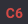 |
| C13 to C18 | 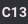 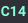 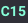 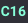  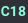 |
| Thera |  |
| Pochven |  |

## Wormhole effect and statics

Wormhole systems show two extra lines: **Effect** and **Statics**.

### Effect

Some wormholes have an effect that changes how ships and modules behave. The colour of the square tells you which one:

| Effect | Square |
|---|---|
| Black Hole |  |
| Cataclysmic Variable |  |
| Magnetar |  |
| Pulsar |  |
| Red Giant |  |
| Wolf-Rayet |  |

Hover the square to see the bonuses and penalties of the effect:

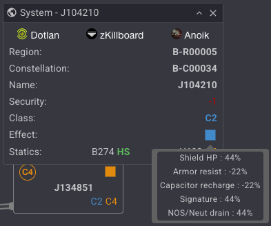

### Statics

Statics are the wormholes that always spawn in the system. Each one shows its type and its destination class:

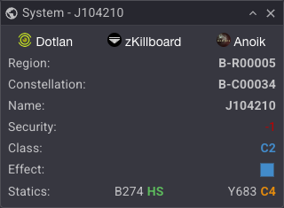

Hover a static to see its mass limits and lifetime:

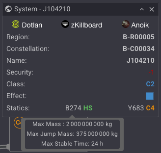

## Notes

The **Notes** window holds one note per system and per map. Everyone who can open the map sees the same note: use it for what your corporation needs to know about the system (residents, structures, what is inside…).

### Write a note

Click the text area and type. The note is saved automatically a few seconds after you stop typing.

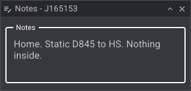

A confirmation appears when the note is saved:

### Delete a note

Clear the text of the note. The empty note is saved like any other change.

:::info
Removing a system from the map does not delete its note. If the system is added again, its note comes back.
:::
